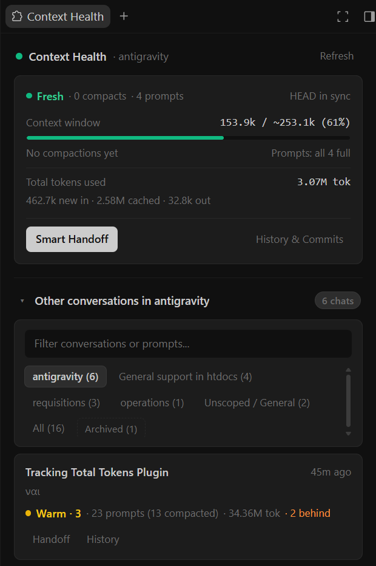
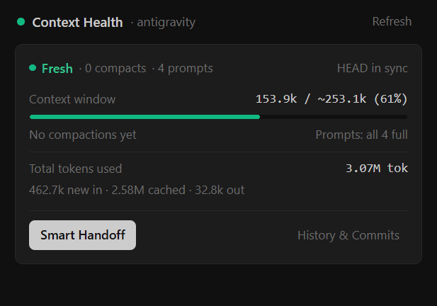
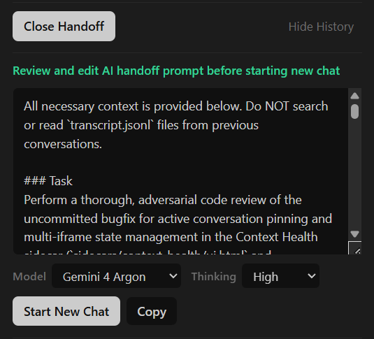

# Antigravity Context Health (`context-health`)

Cross-platform **Antigravity Plugin & Sidecar UI Pane** for **Windows** and **Linux** (pure Node.js, zero external dependencies).

## Overview

As an Antigravity conversation grows, two things silently degrade the agent's effectiveness:
1. **Context Compaction (`CHECKPOINT` events)**: Each time a conversation hits the model's context window ceiling, Antigravity compacts older turns into a summary and retains only the last 10 user prompts verbatim. Repeated compactions gradually dilute earlier architectural constraints and debugging details.
2. **Git Repository Drift (`commits behind HEAD`)**: When commits are created in another terminal, branch, or conversation, an older chat's mental model of the repository falls out of sync with `HEAD`.

**Context Health** runs as a lightweight sidecar panel inside Antigravity (`Auxiliary Pane` and `Sidebar`). It monitors live context window usage, compaction tiers, cumulative token consumption (including spawned subagents), and Git drift across all your projects, and provides a **Two-Step Smart Handoff** to seamlessly continue work in a fresh conversation.

<p align="center">
  
</p>

---

## Features

### 1. Real-Time Context Pollution & Prompt Retention
- **Human-Centric Metrics**: Tracks conversations strictly in terms of **Compacts** (`"type":"CHECKPOINT"`) and **User Prompts** (`"type":"USER_INPUT"`), never raw internal step indices.
- **Compaction Health Tiers**:
  - `0 to 2 compacts` (with `0` compacted prompts): **Fresh** (`#10b981`)
  - `3 to 5 compacts` (or `0 to 2` compacts once earlier prompts are compacted): **Warm** (`#eab308`)
  - `6 to 9 compacts`: **Heavy** (`#f97316`)
  - `10+ compacts`: **Polluted** (`#ef4444`)

<p align="center">
  
</p>
- **Prompt Retention Tracking**: Each Antigravity compaction retains the last 10 user prompts in full. When earlier prompts have been compacted, the active card displays `Prompts: 10 full · M compacted`.
- **Dynamic Context Window Ceiling (Zero Hardcoded Limits)**:
  - Reads `currentTokens = input_tokens + cache_read_tokens` from the latest `PLANNER_RESPONSE`.
  - Records `compactTriggerTokens` immediately preceding each `CHECKPOINT` and computes `observedCompactCeiling` as their rolling median.
  - Adapts automatically if Antigravity changes the context window size in future updates. If `currentTokens` exceeds a previously observed ceiling before a new compact triggers, the stale percentage is hidden (`observing new ceiling`) until the next compaction is observed.

### 2. Total Token Usage & Subagent Breakdown
- Tracks cumulative token usage across every turn of a conversation:
  - **New Input Tokens** (`input_tokens`)
  - **Cached Read Tokens** (`cache_read_tokens`)
  - **Output Tokens** (`output_tokens`)
- Automatically links spawned subagent conversations (`invoke_subagent` / `sender=<uuid>`) to their parent chat, hiding subagents from the main conversation list while aggregating their token consumption (`+X.Xk sub`) on the parent conversation card.

### 3. Git / Repository Drift Detection
- Detects the Git repository root associated with each conversation and compares the conversation's last activity timestamp against `HEAD` (excluding commits created inside that conversation).
- Displays `HEAD in sync` or `N commits behind HEAD`, and lists the missed commit hashes, subjects, and timestamps inside the expandable `History & Commits` drawer.

### 4. Workspace Scoping, Live Activity Indicators, Search & Archiving
- **Pinned Active Chat Card**: Pins the active conversation of the current workspace at the top with a live context meter and token breakdown. Clicking any conversation row in the list switches to that chat in Antigravity and pins it at the top.
- **Project-Scoped Filter Tabs & Live Thinking / Unread Indicators**: Syncs with `~/.gemini/config/projects/` and `window.sidecar.getWorkspaceUris()` (`onWorkspaceChange`) to scope the conversation list to the active project, with tabs to switch across projects or browse `All`. Both project tabs and `Other conversations` cards display animated thinking dots (`•••`) while an agent is streaming or executing tools in the background, transitioning to an unread blue dot (`●`) until that conversation is opened.
- **Quick New Conversation (`+ New`)**: Spawn a new conversation directly from the filter bar inside the current/selected project workspace or as a general (`No Project`) chat without leaving the panel.
- **Turn Previews (`You:` / `AI:`)**: Compact cards in `Other conversations` preview both your latest prompt (`You:`) and the model's latest response (`AI:`) on separate lines.
- **Project & Conversation Archiving / Deletion**: Right-click any project tab to **Archive Project**, or use the bottom-right gear menu (`⚙`) on any conversation card to **Archive** it (restorable from `Archived (N)`) or permanently **Delete** it (`DeleteCascadeTrajectory` with confirmation).
- **Instant Full-Text Search & Prompt History**: Filters conversations in real time across titles, `USER_INPUT` prompts, and `Task Overview` checkpoint summaries. Expanding `History & Commits` shows missed Git commits, the latest compact overview, and user prompts clamped to 3 lines (`Show more` / `Show less`).

### 5. Two-Step Smart Handoff & Dynamic Model Selector
- **Step 1 (Optional Focus & AI Generation)**: Click **Smart Handoff** to open an editable focus box where you can optionally specify instructions for the next chat (such as focusing on a specific subtask or writing the handoff in another language), then click **Generate Handoff Prompt**. Context Health sends a `[Context Health Smart Handoff]` request to the conversation's agent instructing it to produce a self-contained `<HANDOFF_PROMPT>` without calling any tools.
- **Step 2 (Review, Edit, Select Model & Launch)**: As soon as the agent replies, the extracted `<HANDOFF_PROMPT>` is loaded directly into the plugin's editor so you can review or edit it before clicking **Start New Chat** or **Copy**. Clearing the text box (for example with `Ctrl+A` and `Backspace`) automatically switches the drawer back to Step 1 (**Generate Handoff Prompt**) so you can enter new instructions and regenerate.
- **Dynamic Model & Thinking Tier Selector**: Discovers all models and thinking tiers available to your account from the local Antigravity Language Server, pre-selects the active conversation's current model and thinking tier by default, and launches the new conversation directly with the chosen model and thinking tier from Step 0 inside the same project and workspace.

<p align="center">
  
</p>

### 6. Antigravity Contract Verifier & Self-Diagnostics (`--doctor`)
- **Automated AGY Update Protection**: Verifies all 9 internal Antigravity contracts (`plugin_installation_sync`, `app_data_dirs`, `transcript_schema`, `annotations_pbtxt`, `projects_registry`, `language_server_binary`, `language_server_live_rpc`, `agentapi_cli`, and `sidecar_bridge_and_perf`) whenever the sidecar boots or when the `language_server` binary changes on disk after an Antigravity update.
- **Sticky Bottom Warning Drawer**: Stays completely invisible when all contracts pass (`ok`). If an Antigravity update renames or changes an RPC, CLI flag, or transcript schema field, a sticky floating bar appears at the bottom of the panel with a collapsible contract list, **Re-run Doctor**, and **Copy Fix Prompt** (ready to paste into any coding agent with exact failed contract IDs and `server.cjs` symbols).

---

## Installation & Updates (Windows & Linux)

Requires **Node.js 18+**. Works out of the box on both **Windows** and **Linux**.

### Option A: Ask Your Antigravity AI Agent to Install It (Recommended)

You can ask any Antigravity agent to install or update the plugin for you by pasting this prompt in chat:

```text
Install the Context Health plugin from this repository by running `node setup.cjs` (use BypassSandbox: true so it can write to ~/.gemini/config/plugins/context-health), verify with `node setup.cjs --check`, and give me the Context Health sidecar pill link.
```

#### Step-by-Step Instructions for AI Agents
If you are an AI agent asked to install or update **Context Health** on a user's system (Windows or Linux):
1. **Clone or locate the repository** (if not already open in the workspace).
2. **Run the installer outside the sandbox**:
   - Because [`setup.cjs`](./setup.cjs) installs files into `~/.gemini/config/plugins/context-health/` (outside the project workspace) and restarts the running sidecar process, execute `node setup.cjs` with `BypassSandbox: true` if standard sandbox mode blocks writes to `~/.gemini/config`.
3. **Verify the installation**:
   - Run `node setup.cjs --check` and confirm the JSON output reports `"pluginInstalled": true`, `"readmeInstalled": true`, and `"sidecarInstalled": true`.
4. **Surface the sidecar pill & restart notice**:
   - Always include the clickable pill link in your response: `[Context Health](sidecar://context-health/context-health/ui.html)`
   - If this is a **first-time installation** (creating `~/.gemini/config/plugins/context-health` for the first time), inform the user to **restart or reload Antigravity** once so Antigravity discovers the new plugin directory.
   - If this is an **update** to an existing installation, no Antigravity restart is needed (`setup.cjs` automatically restarts `server.cjs` and the UI hot-reloads).

### Option B: Manual CLI Installation

From the repository root on **Windows** or **Linux**:

```bash
node setup.cjs
```

Verify installation status or run the full Antigravity contract verifier (`--doctor`):

```bash
node setup.cjs --check
node setup.cjs --doctor
```

### Updating When New Commits Are Pushed

Because Antigravity runs the plugin from `~/.gemini/config/plugins/context-health/`, pulling new commits in the git repository requires re-running `node setup.cjs` to sync the updated files and auto-restart the sidecar server:

```bash
git pull
node setup.cjs
```

### Uninstalling

To stop the sidecar server and remove the plugin from `~/.gemini/config/plugins/context-health`:

```bash
node setup.cjs --uninstall
```

### Opening the Panel in Antigravity
Once installed, **Context Health** is automatically enabled and available in:
- The right **Auxiliary Pane** (`Extensions` / sidecar tab)
- The left **Sidebar** (`Plugins` section)
- Any Antigravity chat response via the pill link: `[Context Health](sidecar://context-health/context-health/ui.html)`

> [!IMPORTANT]
> **Portability Note (How to Share or Move Across Machines)**:
> Always install on a new Windows or Linux machine by cloning this repository and running `node setup.cjs`. Do **not** copy the installed `~/.gemini/config/plugins/context-health/` folder directly from one computer to another, because `setup.cjs` writes the host machine's resolved Node.js executable path (`process.execPath`, such as an `nvm` or `nvm4w` binary path) into the installed `sidecar.json` so GUI launches can always locate `node`.

---

## Performance Architecture

1. **Incremental Append-Only Transcript Indexing**:
   - [`server.cjs`](./sidecars/context-health/server.cjs) caches `mtimeMs`, `size`, and `parsedBytes` per conversation in memory and persists `index_cache.json`.
   - On subsequent polls, only newly appended bytes (`stat.size - parsedBytes`) are read from disk, and `"type":"GENERIC"` lines are skipped before `JSON.parse` (`< 1 ms` per status poll on warm cache).
2. **Git Reflog Tail Parser + `.git/HEAD` Mtime Guard**:
   - [`server.cjs`](./sidecars/context-health/server.cjs) inspects `.git/HEAD` and `.git/logs/HEAD` `mtimeMs` with a 1.5s TTL before reading Git state.

---

## Repository Structure

```text
.
├── plugin.json                       # Antigravity plugin manifest (auto-enables sidecar)
├── sidecars/
│   └── context-health/
│       ├── sidecar.json              # Antigravity sidecar manifest (AUX_PANE + SIDEBAR)
│       ├── server.cjs                # HTTP + incremental transcript, token & git indexing server
│       └── ui.html                   # Auxiliary pane & sidebar UI
├── screenshots/
│   ├── hero.png                      # Full Context Health panel preview
│   ├── compaction-tiers.gif          # Animated progression across compaction tiers
│   └── smart-handoff.png             # Smart Handoff editor with Model & Thinking Tier selector
├── setup.cjs                         # Cross-platform installer & updater (Windows & Linux)
├── AGENTS.md                         # Instructions & installation runbook for AI coding agents
├── LICENSE                           # MIT License
└── README.md                         # Human & AI agent documentation
```

---

## License

Licensed under the [MIT License](./LICENSE).

